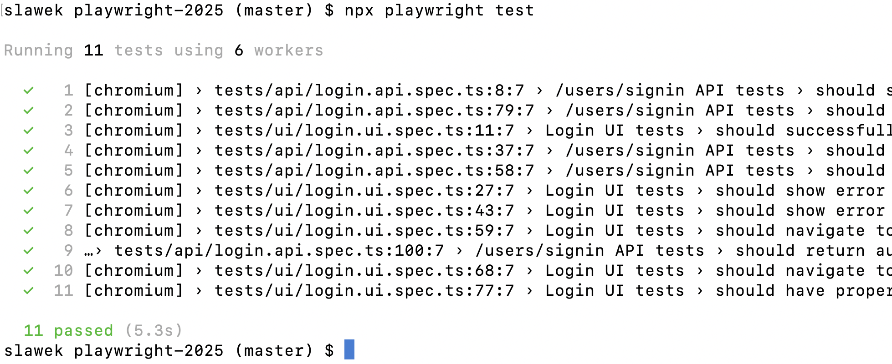

# Playwright and AI Training Environment Setup

Below you will find organizational information and the current environment setup guide for the training.
This guide was verified on August 23, 2026 with the `playwright-2026` repository
and the lightweight `awesome-localstack` profile running locally.
Please prepare carefully. If you run into technical issues, do not worry.
We will solve all problems together during the training.
You can also contact me earlier by email:
[slawomir.radzyminski@gmail.com](mailto:slawomir.radzyminski@gmail.com)

I recommend working on a personal computer because corporate machines often have security restrictions.
A personal computer with full administrator privileges gives more flexibility when solving problems.

# General Training Approach

In addition to theory, during the training we will work on this project:

- [https://github.com/slawekradzyminski/playwright-2026](https://github.com/slawekradzyminski/playwright-2026)

This is the application environment we will use during the course:

- [https://github.com/slawekradzyminski/awesome-localstack](https://github.com/slawekradzyminski/awesome-localstack)

The default classroom scenario is based on the lightweight Docker profile, so this is the profile you should start and verify before the course.

# Software Installation

1. [Install Git](#git-section)
2. [Choose a Code Editor or IDE](#vscode-section)
3. [AI tools for the training](#ai-tools-section)
4. [Install the current Node.js LTS version (currently 24)](#node-section)
   - [macOS](#macos)
   - [Windows](#windows)
5. [Download and install the tested app + environment](#environment-section)
6. [Verify the environment](#verification-section)
7. [Download the test repository](#tests-section)

<a id="git-section"></a>
# 1. Install Git

Git is required to synchronize code during the training.

[https://git-scm.com/book/en/v2/Getting-Started-Installing-Git](https://git-scm.com/book/en/v2/Getting-Started-Installing-Git)

If you are not comfortable with terminal-based installation, the guide above also includes links to classic installers for Windows and macOS.

- macOS: [https://git-scm.com/download/mac](https://git-scm.com/download/mac)
- Windows: [https://git-scm.com/download/win](https://git-scm.com/download/win)

<a id="vscode-section"></a>
# 2. Choose a Code Editor or IDE

Prepare a code editor or IDE for opening the project, editing, and managing Playwright test code. You can use any tool that supports JavaScript and TypeScript, including the one you already use at work.

The most popular choice is **Visual Studio Code (VS Code)** ([Stack Overflow Developer Survey](https://survey.stackoverflow.co/2025/)). If you do not have a preferred editor yet, I recommend starting with it.

Download links — you only need one of these tools:

- [Visual Studio Code](https://code.visualstudio.com/download)
- [WebStorm (JetBrains)](https://www.jetbrains.com/webstorm/download/)
- [Cursor](https://cursor.com/download)

After downloading the test repository, open the entire `playwright-2026` folder in your chosen editor.
In VS Code, use **File → Open Folder…**. The integrated terminal (**Terminal → New Terminal**) lets you run the commands and tests described later in this guide. In another IDE, use the equivalent options or a separate terminal.

<a id="ai-tools-section"></a>
# 3. AI Tools for the Training

One working AI tool is enough. If you already use a tool successfully at work, you can keep using it.
If you are choosing your first tool, these are my recommendations for this workshop.

Recommendations and prices checked on October 31, 2026. Prices below are in USD with monthly billing;
taxes, regional prices, promotions, and limits may vary. Check the current pricing before purchasing.
A subscription does not guarantee unlimited agent usage throughout the day.

## Recommended: Claude Code and Codex

1. **Claude Code + Claude Pro — USD 20/month.**
   This is my first choice for participants starting to work with an agent in this workshop.
   Pro includes Claude Code; you do not need to purchase separate API access.
   Usage limits apply and are shared with other Claude features.
   - [Installation and first steps](https://code.claude.com/docs/en/quickstart)
   - [Claude Pro pricing](https://claude.com/pricing)

2. **Codex + ChatGPT Plus — USD 20/month.**
   This is my second recommended option. You can work locally with Codex in the app, IDE, or terminal.
   Sign in with your ChatGPT Plus account. A separate API key is not required;
   API-key usage is billed separately from your subscription. Usage limits also apply.
   - [Codex quickstart](https://developers.openai.com/codex/quickstart/)
   - [Codex plans, pricing, and limits](https://developers.openai.com/codex/pricing/)

These are my recommendations for the exercises, rather than a guarantee that one agent is best at every task.
You do not need both subscriptions or a more expensive plan to get started.

## Other options: Cursor and GitHub Copilot

Both tools are suitable for the workshop, especially if you already use them.
Intensive agent use can become relatively expensive: model costs, credit consumption, and additional charges
matter alongside the subscription fee. This is why I prefer the two tools above for beginners.

- **Cursor** — an editor with an AI agent. Model availability and billing depend on the plan;
  third-party model usage may be charged separately.
  [Pricing and billing details](https://cursor.com/pricing).
- **GitHub Copilot** — IDE integration and CLI. Pro starts at **USD 10/month**,
  so the entry subscription costs less than the recommended plans.
  Agent features consume GitHub AI Credits, and extra usage may require additional payment.
  [Pricing](https://github.com/features/copilot/plans),
  [quickstart](https://docs.github.com/en/copilot/get-started/quickstart).

## Budget options and Chinese model providers

If cost is your priority, consider the options below.
A lower subscription price does not imply identical quality, limits, or setup convenience.

- **Qwen Code + Alibaba Cloud Model Studio Token Plan** — Token Plan Lite has a standard price
  of **USD 8/month**, with a currently advertised promotional price of **USD 6/month**.
  The offer is available in the Singapore region. This is separate from the old Coding Plan Lite,
  which is no longer available for purchase.
  [Current plan and pricing](https://www.alibabacloud.com/help/en/model-studio/token-plan-overview),
  [Qwen Code authentication](https://qwenlm.github.io/qwen-code-docs/en/users/configuration/auth/).
- **GLM Coding Plan (Z.AI)** — GLM models in a supported agent, such as Claude Code or OpenCode.
  Standard Lite pricing starts at **USD 18/month**; promotions may reduce it.
  Choosing GLM in Claude Code means using Z.AI's service, with its own limits and billing.
  [Plan overview and limits](https://docs.z.ai/devpack/overview),
  [setup](https://docs.z.ai/devpack/quick-start).
- **Kimi Code (Moonshot AI)** — an alternative agent and Kimi models.
  Before buying, check whether the selected plan includes Kimi Code:
  current documentation requires **Plus or higher for new plans**; Go has no coding quota.
  [Plan availability and limits](https://www.kimi.com/code/docs/en/kimi-code/membership.html),
  [getting started](https://www.kimi.com/code/docs/en/kimi-code-cli/guides/getting-started.html).
- **OpenCode** — an open-source agent client with your choice of provider and model;
  the client itself does not provide free access to every model.
  The optional **OpenCode Go costs USD 10/month** and provides selected models within usage limits.
  **I generally do not recommend OpenCode as your first tool for the workshop**:
  it requires additional model selection, provider setup, and understanding of billing.
  It suits participants who want to experiment deliberately with configuration.
  [OpenCode documentation](https://opencode.ai/docs/),
  [OpenCode Go pricing and setup](https://opencode.ai/docs/go/).

## Check your tool before the workshop

The agent should run on the same computer as the application or be able to execute commands
in your local terminal. Before the workshop, check that it can open the repository, edit files,
and run commands and tests. A browser chat alone is insufficient for these exercises.
An agent running only in a remote cloud environment usually cannot see your `http://localhost:8081`
without additional configuration. Do not paste API keys into prompts, repository files,
or logs shared with other people.

Even when the client is open source or has a Free plan, model access may still be paid or limited.

<a id="node-section"></a>
# 4. Install the Current Node.js LTS Version (Currently 24)

Node.js is required for the test code.

I strongly recommend installing `nvm` (Node Version Manager).
It is the most convenient way to manage Node.js versions on your computer.
For the training, use only the current Node.js LTS version, which is currently 24.

## macOS

[Official nvm installation guide](https://github.com/nvm-sh/nvm#installing-and-updating)

## Windows

- [https://github.com/coreybutler/nvm-windows](https://github.com/coreybutler/nvm-windows)
- [Latest nvm-windows release](https://github.com/coreybutler/nvm-windows/releases/latest)

If you run into access or command execution issues on Windows with PowerShell, running this command may help:

```powershell
Set-ExecutionPolicy -Scope CurrentUser -ExecutionPolicy RemoteSigned
```

**Verification**

```bash
node --version
```

Expected version:

```bash
v24.x.x
```

<a id="environment-section"></a>
# 5. Download and Install the Tested App + Environment

A Docker-based environment is strongly preferred because you do not need to worry about starting individual applications.
If necessary, we can also install the frontend and backend in an alternative way.

Docker and Docker Compose installation guide:
[https://docs.docker.com/compose/install/](https://docs.docker.com/compose/install/)

Rancher Desktop can be used as an alternative to Docker Desktop:
[https://docs.rancherdesktop.io/getting-started/installation/](https://docs.rancherdesktop.io/getting-started/installation/)

```bash
git clone https://github.com/slawekradzyminski/awesome-localstack
cd awesome-localstack
```

Inside the downloaded folder, start the lightweight training profile:

```bash
docker compose -f lightweight-docker-compose.yml up -d
```

This starts one public application gateway at:

- `http://localhost:8081`

Behind this gateway you have:

- frontend
- backend API under `/api/v1/...`
- Swagger UI
- product images under `/images/...`
- mock LLM on a separate port `11434`
- Keycloak / SSO on a separate port `8082`

For a more detailed lightweight-profile walkthrough, URLs, and verification steps, use:

- [awesome-localstack/docs/STUDENT_GUIDE.md](https://github.com/slawekradzyminski/awesome-localstack/blob/main/docs/STUDENT_GUIDE.md)

<a id="verification-section"></a>
# 6. Verify the Environment

After startup, run:

```bash
docker compose -f lightweight-docker-compose.yml ps
curl -i http://localhost:8081/login
curl -i http://localhost:8081/v3/api-docs
curl -i http://localhost:8081/images/iphone.png
curl -i http://localhost:8082/realms/awesome-testing/.well-known/openid-configuration
curl -i -X POST http://localhost:11434/api/generate \
  -H 'Content-Type: application/json' \
  -d '{"model":"qwen3.5:2b","prompt":"hello"}'
```

Expected result:

- the `backend`, `frontend`, `gateway`, `keycloak`, and `ollama-mock` services are in the `Up` state
- the login page returns `200`
- OpenAPI returns `200`
- the product image returns `200`
- the Keycloak OpenID Connect configuration returns `200`
- the mock LLM returns `200`

Useful browser URLs:

- app: `http://localhost:8081/login`
- Swagger: `http://localhost:8081/swagger-ui/index.html`
- Keycloak: `http://localhost:8082`

In Windows PowerShell, use `curl.exe` instead of `curl` if the name is intercepted
by a PowerShell alias.

Local credentials:

- standard app login: `client` / `client`
- standard administrator account: `admin` / `LocalDemoAdmin123!`
- SSO through Keycloak: `sso-client` / `SsoClient123!`
- Social login (Google mock): `google-user` / `GoogleUser123!`
- Social login (GitHub mock): `github-user` / `GitHubUser123!`
- Keycloak admin console: `admin` / `admin`

If something is still starting, check logs first:

```bash
docker compose -f lightweight-docker-compose.yml logs -f backend gateway
docker compose -f lightweight-docker-compose.yml logs -f keycloak ollama-mock
```

<a id="tests-section"></a>
# 7. Download the Test Repository

```bash
git clone https://github.com/slawekradzyminski/playwright-2026
cd playwright-2026
```

Run:

```bash
npm ci
npx playwright install chromium
npx playwright test
```



The tests require the environment from section 5 and go through the main application URL:

- `http://localhost:8081`

The current login API endpoint used by the tests is:

- `http://localhost:8081/api/v1/users/signin`

If you have any trouble, feel free to contact me.
