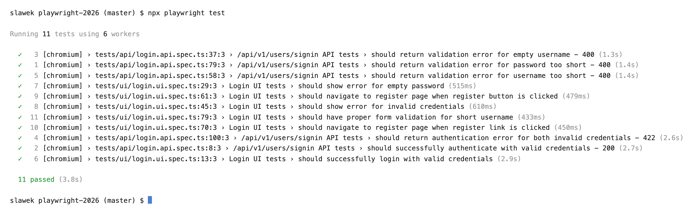

# Playwright and AI Training Environment Setup

Below you will find organizational information and the current environment setup guide for the training.
This guide was verified on November 10, 2026 with the `playwright-2026` repository
and the lightweight `awesome-localstack` profile running locally.
Please prepare carefully. If you run into technical issues, do not worry.
We will solve all problems together during the training.
You can also contact me earlier by email:
[slawomir.radzyminski@gmail.com](mailto:slawomir.radzyminski@gmail.com)

I recommend working on a personal computer because corporate machines often have security restrictions.
A personal computer with full administrator privileges gives more flexibility when solving problems.

## In Short

**Your environment is ready when `npx playwright test` in the `playwright-2026` folder ends with `11 passed`.**
Everything below leads to that one result.

- **When:** at least a few days before the training. Docker images and the browser are about 1.2 GB to download,
  and possible issues (Docker licence, permissions, proxy) are easier to solve without time pressure.
- **How long:** usually 30–60 minutes, often less with an AI agent.
- **What you need:**
  - macOS, Windows 10/11 (with WSL 2) or Linux, ideally with administrator rights;
  - at least 8 GB of RAM in the computer (16 GB is comfortable), of which you should give Docker about 4 GB (the training stack itself uses about 1.5 GB);
  - about 5 GB of free disk space;
  - free ports `8081`, `8082` and `11434`.
- **Docker Desktop or Rancher Desktop:** both work. If Docker Desktop requires a paid licence at your company,
  choose Rancher Desktop ([section 5](#environment-section)).
- **If Docker cannot run at all:** you can run the tests against the shared training environment
  ([plan B](#plan-b-section)). A local Docker setup is still strongly preferred.
- **Refresher before the training (optional):** if you have not coded for a while, go through the
  [JavaScript and TypeScript basics](typescript/README.md), then the [Playwright refresher](playwright/README.md).

# Recommended: Set Up with an AI Agent

**I encourage you to do the whole setup with an AI agent** (for example Claude Code, Codex, Copilot CLI or Cursor).
It is the fastest route and a good warm-up for the training, where we will work with agents anyway.
The agent checks what you already have, runs the commands, reads the logs and proposes fixes when something fails.

How to do it:

1. Install **Git** ([section 1](#git-section)), an **editor** ([section 2](#vscode-section)) and an **AI agent** ([section 3](#ai-tools-section)) yourself.
   The agent must run locally with terminal access; a chat in the browser is not enough.
2. Create an empty folder for the training projects, open a terminal there and start the agent.
3. Turn on the agent's auto-approve mode (details below) so you don't have to approve every command.
4. Paste one of the prompts below. The agent will guide you through the rest (sections 4–7) step by step.

**The lazy version:** just give the agent a link to this guide and one sentence:

```text
Set up my computer for the training following this guide, and tell me at the end whether everything works:
https://github.com/slawekradzyminski/AI_instrukcja/blob/master/AI_Instructions_EN.md
```

If your agent has no internet access, copy the whole guide, paste it into the agent
and add: "Do this setup on my computer and tell me at the end whether everything works."

**The more thorough version** — a prompt that walks the agent through each step and ends with a results table:

```text
Help me prepare my computer for the Playwright and AI training.
Follow this guide (sections 4–7):
https://github.com/slawekradzyminski/AI_instrukcja/blob/master/AI_Instructions_EN.md

1. Check my operating system and what is already installed: git, nvm, Node.js, Docker and Docker Compose.
2. Get to this state: Node.js 24 LTS (preferably via nvm) and a working Docker with Docker Compose.
   If Docker Desktop is not an option (e.g. company licensing), use Rancher Desktop
   with the dockerd (moby) engine and Kubernetes disabled, as described in section 5.
3. In the current folder, clone awesome-localstack and playwright-2026 if they are not there yet.
4. In awesome-localstack, start the lightweight profile
   (docker compose -f lightweight-docker-compose.yml up -d)
   and run every check from section 6.
5. In playwright-2026, run: npm ci, npx playwright install chromium, npx playwright test.
   Expected result: 11 passed.
6. If local Docker cannot be started, do not give up: switch the tests to the shared
   environment as described in the "Plan B" section and run them again.

Rules:
- Before installing anything or changing system settings, explain what you want to do and wait for my approval.
- If a step needs administrator rights or a graphical installer (e.g. Docker Desktop),
  give me exact instructions and wait until I have done it.
- Never ask me for passwords or API keys in the chat.
- When something fails, read the logs, find the cause and propose a fix.
- Finish with a table: step, result (OK / problem), tool versions and the Playwright test result.
```

## Recommended: Auto-Approve Mode

The setup involves dozens of commands. Approving each one by hand quickly gets tedious and adds little,
so **I recommend turning on auto-approve**. Ideally use a mode in which a separate model or classifier checks
every action: safe commands run straight away, while risky ones are blocked or come back to you.

- **Claude Code — auto mode.** Press `Shift+Tab` until the status line shows *auto mode*.
  Availability depends on your plan and version; if the mode is not listed, check the docs.
  [Permission modes](https://code.claude.com/docs/en/permission-modes)
- **Codex — Auto-review.** Choose Auto-review in the approval settings of the app or IDE.
  In the CLI, set `approval_policy = "on-request"` and `approvals_reviewer = "auto_review"` in `~/.codex/config.toml`.
  [Auto-review](https://developers.openai.com/codex/concepts/sandboxing/auto-review)
- **Cursor — Auto-review.** This is the default run mode; find it under Cursor Settings → Agents → Approvals & Execution.
  [Run Modes](https://cursor.com/docs/agent/security/run-modes)
- **GitHub Copilot CLI — autopilot with `/allow-all`.** Press `Shift+Tab` until *Autopilot* is shown and grant all permissions
  (or type `/allow-all`). There is no separate reviewer here, so use this mode only on your own computer
  and in the training folder. [Autopilot](https://docs.github.com/en/copilot/concepts/agents/copilot-cli/autopilot)

A few safety rules, also in auto mode:

- Keep an eye on what the agent does, especially when it installs software or changes things outside the training folder.
- Type an administrator password only into the operating system or installer prompt, never into the agent chat.
- Avoid modes with no checks at all (e.g. *Full access* in Codex, *Run Everything* in Cursor),
  especially on a work computer.
- If the agent gets stuck or something is unclear, the manual guide below describes the same steps.
  You can also bring the result to the training and we will solve it together.

The agent's summary (the table from the last point of the prompt) is the best proof that your environment is ready.
Keep it in case questions come up during the training.

# General Training Approach

In addition to theory, during the training we will work on this project:

- [https://github.com/slawekradzyminski/playwright-2026](https://github.com/slawekradzyminski/playwright-2026)

This is the application environment we will use during the course:

- [https://github.com/slawekradzyminski/awesome-localstack](https://github.com/slawekradzyminski/awesome-localstack)

The default classroom scenario is based on the lightweight Docker profile, so this is the profile you should start and verify before the course.

# Software Installation (Manual Guide)

If you set up with an AI agent, you do steps 1–3 yourself and the agent guides you through steps 4–7.
The sections below describe the same steps manually and serve as a reference.

1. [Install Git](#git-section)
2. [Choose a Code Editor or IDE](#vscode-section)
3. [AI tools for the training](#ai-tools-section)
4. [Install the current Node.js LTS version (currently 24)](#node-section)
   - [macOS](#macos)
   - [Windows](#windows)
5. [Download and install the tested app + environment (Docker Desktop or Rancher Desktop)](#environment-section)
6. [Verify the environment](#verification-section)
7. [Download the test repository](#tests-section)

Also: [Plan B without Docker](#plan-b-section) and [Common problems](#problems-section).

<a id="git-section"></a>
# 1. Install Git

Git is required to synchronize code during the training.

[https://git-scm.com/book/en/v2/Getting-Started-Installing-Git](https://git-scm.com/book/en/v2/Getting-Started-Installing-Git)

If you are not comfortable with terminal-based installation, the guide above also includes links to classic installers for Windows and macOS.

- macOS: [https://git-scm.com/download/mac](https://git-scm.com/download/mac)
- Windows: [https://git-scm.com/download/win](https://git-scm.com/download/win)

<a id="vscode-section"></a>
# 2. Choose a Code Editor or IDE

Prepare a code editor or IDE for opening the project, editing, and managing Playwright test code. You can use any tool that supports JavaScript and TypeScript, including the one you already use at work.

The most popular choice is **Visual Studio Code (VS Code)** ([Stack Overflow Developer Survey](https://survey.stackoverflow.co/2025/)). If you do not have a preferred editor yet, I recommend starting with it.

Download links — you only need one of these tools:

- [Visual Studio Code](https://code.visualstudio.com/download)
- [WebStorm (JetBrains)](https://www.jetbrains.com/webstorm/download/)
- [Cursor](https://cursor.com/download)

After downloading the test repository, open the entire `playwright-2026` folder in your chosen editor.
In VS Code, use **File → Open Folder…**. The integrated terminal (**Terminal → New Terminal**) lets you run the commands and tests described later in this guide. In another IDE, use the equivalent options or a separate terminal.

<a id="ai-tools-section"></a>
# 3. AI Tools for the Training

One working AI tool is enough. If you already use a tool successfully at work, you can keep using it.
If you are choosing your first tool, these are my recommendations for this workshop.

Recommendations and prices checked on October 31, 2026. Prices below are in USD with monthly billing;
taxes, regional prices, promotions, and limits may vary. Check the current pricing before purchasing.
A subscription does not guarantee unlimited agent usage throughout the day.

## Recommended: Claude Code and Codex

1. **Claude Code + Claude Pro — USD 20/month.**
   This is my first choice for participants starting to work with an agent in this workshop.
   Pro includes Claude Code; you do not need to purchase separate API access.
   Usage limits apply and are shared with other Claude features.
   - [Installation and first steps](https://code.claude.com/docs/en/quickstart)
   - [Claude Pro pricing](https://claude.com/pricing)

2. **Codex + ChatGPT Plus — USD 20/month.**
   This is my second recommended option. You can work locally with Codex in the app, IDE, or terminal.
   Sign in with your ChatGPT Plus account. A separate API key is not required;
   API-key usage is billed separately from your subscription. Usage limits also apply.
   - [Codex quickstart](https://developers.openai.com/codex/quickstart/)
   - [Codex plans, pricing, and limits](https://developers.openai.com/codex/pricing/)

These are my recommendations for the exercises, rather than a guarantee that one agent is best at every task.
You do not need both subscriptions or a more expensive plan to get started.

## Other options: Cursor and GitHub Copilot

Both tools are suitable for the workshop, especially if you already use them.
Intensive agent use can become relatively expensive: model costs, credit consumption, and additional charges
matter alongside the subscription fee. This is why I prefer the two tools above for beginners.

- **Cursor** — an editor with an AI agent. Model availability and billing depend on the plan;
  third-party model usage may be charged separately.
  [Pricing and billing details](https://cursor.com/pricing).
- **GitHub Copilot** — IDE integration and CLI. Pro starts at **USD 10/month**,
  so the entry subscription costs less than the recommended plans.
  Agent features consume GitHub AI Credits, and extra usage may require additional payment.
  [Pricing](https://github.com/features/copilot/plans),
  [quickstart](https://docs.github.com/en/copilot/get-started/quickstart).

## Budget options and Chinese model providers

If cost is your priority, consider the options below.
A lower subscription price does not imply identical quality, limits, or setup convenience.

- **Qwen Code + Alibaba Cloud Model Studio Token Plan** — Token Plan Lite has a standard price
  of **USD 8/month**, with a currently advertised promotional price of **USD 6/month**.
  The offer is available in the Singapore region. This is separate from the old Coding Plan Lite,
  which is no longer available for purchase.
  [Current plan and pricing](https://www.alibabacloud.com/help/en/model-studio/token-plan-overview),
  [Qwen Code authentication](https://qwenlm.github.io/qwen-code-docs/en/users/configuration/auth/).
- **GLM Coding Plan (Z.AI)** — GLM models in a supported agent, such as Claude Code or OpenCode.
  Standard Lite pricing starts at **USD 18/month**; promotions may reduce it.
  Choosing GLM in Claude Code means using Z.AI's service, with its own limits and billing.
  [Plan overview and limits](https://docs.z.ai/devpack/overview),
  [setup](https://docs.z.ai/devpack/quick-start).
- **Kimi Code (Moonshot AI)** — an alternative agent and Kimi models.
  Before buying, check whether the selected plan includes Kimi Code:
  current documentation requires **Plus or higher for new plans**; Go has no coding quota.
  [Plan availability and limits](https://www.kimi.com/code/docs/en/kimi-code/membership.html),
  [getting started](https://www.kimi.com/code/docs/en/kimi-code-cli/guides/getting-started.html).
- **OpenCode** — an open-source agent client with your choice of provider and model;
  the client itself does not provide free access to every model.
  The optional **OpenCode Go costs USD 10/month** and provides selected models within usage limits.
  **I generally do not recommend OpenCode as your first tool for the workshop**:
  it requires additional model selection, provider setup, and understanding of billing.
  It suits participants who want to experiment deliberately with configuration.
  [OpenCode documentation](https://opencode.ai/docs/),
  [OpenCode Go pricing and setup](https://opencode.ai/docs/go/).

## Check your tool before the workshop

The agent should run on the same computer as the application or be able to execute commands
in your local terminal. Before the workshop, check that it can open the repository, edit files,
and run commands and tests. A browser chat alone is insufficient for these exercises.
An agent running only in a remote cloud environment usually cannot see your `http://localhost:8081`
without additional configuration. Do not paste API keys into prompts, repository files,
or logs shared with other people.

Even when the client is open source or has a Free plan, model access may still be paid or limited.

<a id="node-section"></a>
# 4. Install the Current Node.js LTS Version (Currently 24)

Node.js is required for the test code.

I strongly recommend installing `nvm` (Node Version Manager).
It is the most convenient way to manage Node.js versions on your computer.
For the training, use only the current Node.js LTS version, which is currently 24.

## macOS

[Official nvm installation guide](https://github.com/nvm-sh/nvm#installing-and-updating)

## Windows

- [https://github.com/coreybutler/nvm-windows](https://github.com/coreybutler/nvm-windows)
- [Latest nvm-windows release](https://github.com/coreybutler/nvm-windows/releases/latest)

If you run into access or command execution issues on Windows with PowerShell, running this command may help:

```powershell
Set-ExecutionPolicy -Scope CurrentUser -ExecutionPolicy RemoteSigned
```

**Verification**

```bash
node --version
```

Expected version:

```bash
v24.x.x
```

<a id="environment-section"></a>
# 5. Download and Install the Tested App + Environment

The application runs in containers, so you do not install the frontend, backend or database separately.
You need **Docker with Docker Compose**. There are two applications to choose from — one is enough.

## Option A: Docker Desktop

[Install Docker Desktop](https://docs.docker.com/get-started/get-docker/)

Docker Desktop is free for personal use, education and small businesses.
Larger organizations (250+ employees or USD 10 million+ in annual revenue) need a paid subscription
([licence terms](https://docs.docker.com/subscription/desktop-license/)).
If you are not sure whether you may use it on a work computer, choose Rancher Desktop.

## Option B: Rancher Desktop (free alternative)

[Install Rancher Desktop](https://docs.rancherdesktop.io/getting-started/installation/)

Rancher Desktop is free for companies too. To make it work with our `docker compose` commands,
set the following in **Preferences** after installation:

1. **Container Engine → dockerd (moby)**. With the `containerd` engine, `docker` commands will not work.
2. **Kubernetes → uncheck "Enable Kubernetes"**. It is not needed for the training and uses memory.
3. **Virtual Machine → Memory: at least 4 GB** (macOS and Linux). On Windows, memory is managed by WSL 2.

On Windows, Rancher Desktop (like Docker Desktop) uses **WSL 2**; the installer helps you enable it.
After changing settings, wait for Rancher Desktop to restart and open a **new** terminal.

## Check Docker

Whichever option you chose, both commands must print a version:

```bash
docker version
docker compose version
```

If `docker` is not recognized, see [Common problems](#problems-section).

## Start the Application

```bash
git clone https://github.com/slawekradzyminski/awesome-localstack
cd awesome-localstack
```

Inside the downloaded folder, start the lightweight training profile:

```bash
docker compose -f lightweight-docker-compose.yml up -d
```

On the first start Docker builds the documentation image (`docs`) locally, so
it needs internet access and takes a moment.

This starts one public application gateway at:

- `http://localhost:8081`

Behind this gateway you have:

- frontend
- backend API under `/api/v1/...`
- warehouse API (shipments, parcel tracking, returns, purchasing) served by `warehouse-service`
- payments API (test cards, 3-D Secure, refunds) served by `payment-service`
- technical and business documentation (wiki) under `/docs/`
- Swagger UI
- product images under `/images/...`
- mock LLM on a separate port `11434`
- Keycloak / SSO on a separate port `8082`

For a more detailed lightweight-profile walkthrough, URLs, and verification steps, use:

- [awesome-localstack/docs/STUDENT_GUIDE.md](https://github.com/slawekradzyminski/awesome-localstack/blob/main/docs/STUDENT_GUIDE.md)

<a id="verification-section"></a>
# 6. Verify the Environment

After startup, run:

```bash
docker compose -f lightweight-docker-compose.yml ps -a
curl -i http://localhost:8081/login
curl -i http://localhost:8081/v3/api-docs
curl -i http://localhost:8081/images/iphone.png
curl -i http://localhost:8081/warehouse/v3/api-docs
curl -i http://localhost:8081/payment/v3/api-docs
curl -i http://localhost:8081/docs/
curl -i http://localhost:8082/realms/awesome-testing/.well-known/openid-configuration
curl -i -X POST http://localhost:11434/api/generate \
  -H 'Content-Type: application/json' \
  -d '{"model":"qwen3.5:2b","prompt":"hello"}'
```

Expected result:

- the `backend`, `docs`, `frontend`, `gateway`, `keycloak`, `ollama-mock`, `payment-service`, `postgres` and `warehouse-service` services are in the `Up` state
- the one-shot `postgres-roles` and `keycloak-init` containers show `Exited (0)` — that is correct, they stop after preparing the database and the accounts
- the login page returns `200`
- OpenAPI returns `200` (backend, warehouse and payments)
- the documentation wiki returns `200`
- the product image returns `200`
- the Keycloak OpenID Connect configuration returns `200`
- the mock LLM returns `200`

Useful browser URLs:

- app: `http://localhost:8081/login`
- Swagger: `http://localhost:8081/swagger-ui/index.html` (definitions: backend, warehouse, payments)
- documentation wiki: `http://localhost:8081/docs/`
- Keycloak: `http://localhost:8082`

In Windows PowerShell, use `curl.exe` instead of `curl` if the name is intercepted
by a PowerShell alias.

Local credentials:

- standard app login: `client` / `client`
- standard administrator account: `admin` / `LocalDemoAdmin123!`
- warehouse account (shipments, returns, purchasing): `warehouse` / `warehouse`
- SSO through Keycloak: `sso-e2e-client` / `SsoClient123!`
- Social login (Google mock): `google-user` / `GoogleUser123!`
- Social login (GitHub mock): `github-user` / `GitHubUser123!`
- Keycloak admin console: `admin` / `admin`

If something is still starting, check logs first:

```bash
docker compose -f lightweight-docker-compose.yml logs -f backend gateway
docker compose -f lightweight-docker-compose.yml logs -f keycloak ollama-mock
docker compose -f lightweight-docker-compose.yml logs -f postgres warehouse-service payment-service
```

The database runs in memory, so after `docker compose -f lightweight-docker-compose.yml down` and another `up -d`
the application starts again from the seed data. Your changes (registrations, orders) are gone — that is intended for the training.

<a id="tests-section"></a>
# 7. Download the Test Repository

```bash
git clone https://github.com/slawekradzyminski/playwright-2026
cd playwright-2026
```

Run:

```bash
npm ci
npx playwright install chromium
npx playwright test
```



The expected result is `11 passed`, as in the screenshot above.

The tests require the environment from section 5 and go through the main application URL:

- `http://localhost:8081`

The current login API endpoint used by the tests is:

- `http://localhost:8081/api/v1/users/signin`

The application URL is set in the `.env` file of the `playwright-2026` repository
(`APP_BASE_URL=http://localhost:8081`).

<a id="plan-b-section"></a>
# Plan B: When Docker Cannot Run

If local Docker still does not work after trying (e.g. restrictions on a work computer), do not skip the preparation.
You can run the tests against the shared training environment with the same application:

1. In the `playwright-2026` repository, open the `.env` file.
2. Change the URL to:

   ```dotenv
   APP_BASE_URL=https://aitesters.byst.re
   ```

3. Run the tests: `npx playwright test`. The expected result is also `11 passed`.

This is a fallback: the environment is shared by all participants, so data can change,
and some exercises may require a local environment. Let me know before the training
that you are using plan B, and we will look for a solution together.

<a id="problems-section"></a>
# Common Problems

**First step for any problem: paste the error message into your AI agent and ask it to fix it.**
Ideally include the command you ran and your operating system. The training is about working with AI,
so this already counts as a warm-up 😏

If the agent gives up too, here are the most common causes:

- **`docker: command not found` after installing Rancher Desktop** — check that Preferences → Container Engine
  is set to **dockerd (moby)**, then open a new terminal (or restart the computer).
- **A port is already in use (`port is already allocated`)** — another application already uses `8081`, `8082` or `11434`.
  Most often it is a locally installed **Ollama** (port `11434`) or another Docker project.
  Stop it for the training or check what uses the port:
  `lsof -i :11434` (macOS/Linux) or `netstat -ano | findstr 11434` (Windows).
- **Images do not download (timeout, certificate error)** — this is often a company VPN or proxy.
  Try without the VPN or on a private network.
- **A container keeps restarting or a service never becomes ready** — give Docker more memory (at least 4 GB)
  and check the logs: `docker compose -f lightweight-docker-compose.yml logs -f backend gateway`.
- **`npx playwright install chromium` fails** — usually a proxy as well; try another network.
- **Windows: `curl` behaves differently** — in PowerShell, use `curl.exe` instead of `curl`.
- **Tests fail** — check that the application works at `http://localhost:8081/login`
  and that the `.env` file has the right URL.

If you have any trouble, ask your agent first 😏, and if that does not help, feel free to contact me.
