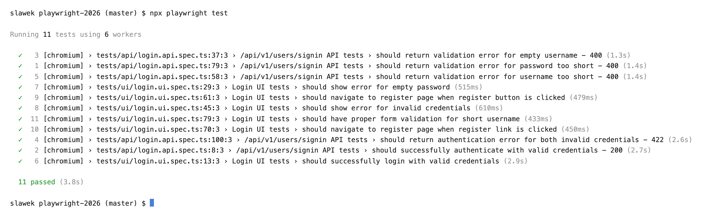

# Przygotowanie środowiska do szkolenia z Playwright i AI

Poniżej znajdziecie organizacyjne informacje oraz aktualną instrukcję przygotowania środowiska na szkolenie.
Instrukcja została zweryfikowana 10 listopada 2026 r. z repozytorium `playwright-2026`
i lekkim profilem `awesome-localstack` uruchomionym lokalnie.
Proszę o sumienne przygotowanie. Jeśli pojawią się trudności techniczne, niczym się nie martwcie.
Wszystkie problemy rozwiążemy wspólnie na szkoleniu.
Można też skontaktować się ze mną wcześniej mailowo:
[slawomir.radzyminski@gmail.com](mailto:slawomir.radzyminski@gmail.com)

Zalecam pracę na komputerze prywatnym, ze względu na częste ograniczenia bezpieczeństwa na komputerach służbowych.
Prywatny komputer z pełnymi uprawnieniami administratora daje większą elastyczność w rozwiązywaniu problemów.

## W skrócie

**Środowisko jest gotowe, gdy w folderze `playwright-2026` komenda `npx playwright test` kończy się wynikiem `11 passed`.**
Wszystko poniżej prowadzi do tego jednego wyniku.

- **Kiedy:** najpóźniej kilka dni przed szkoleniem. Pobieranie obrazów Dockera i przeglądarki to około 1,2 GB,
  a ewentualne problemy (licencja Dockera, uprawnienia, proxy) łatwiej rozwiązać bez pośpiechu.
- **Ile to trwa:** zwykle 30–60 minut, z agentem AI często krócej.
- **Czego potrzebujecie:**
  - macOS, Windows 10/11 (z WSL 2) albo Linux, najlepiej z uprawnieniami administratora;
  - co najmniej 8 GB RAM w komputerze (16 GB zapewnia wygodną pracę), z czego warto dać Dockerowi około 4 GB (samo środowisko szkoleniowe zajmuje poniżej 1 GB);
  - około 5 GB wolnego miejsca na dysku;
  - wolne porty `8081` i `11434`.
- **Docker Desktop albo Rancher Desktop:** oba działają. Jeśli w Waszej firmie Docker Desktop wymaga płatnej licencji,
  wybierzcie Rancher Desktop ([sekcja 5](#sekcja-srodowisko)).
- **Gdy Dockera nie da się uruchomić:** testy można puścić na wspólnym środowisku szkoleniowym
  ([plan B](#sekcja-plan-b)). Lokalny Docker jest jednak zdecydowanie preferowany.
- **Powtórka przed szkoleniem (opcjonalnie):** jeśli dawno nie programowaliście, przejrzyjcie
  [podstawy JavaScript i TypeScript](typescript/README.md), a potem [powtórkę z Playwright](playwright/README.md).

# Polecany sposób: setup z agentem AI

**Zachęcam, żeby całą konfigurację zrobić z pomocą agenta AI** (np. Claude Code, Codex, Copilot CLI lub Cursor).
To najszybsza droga, a przy okazji dobra rozgrzewka przed szkoleniem, na którym i tak będziemy pracować z agentami.
Agent sam sprawdzi, co macie już zainstalowane, uruchomi komendy, przeczyta logi i zaproponuje poprawki, gdy coś nie zadziała.

Jak to zrobić:

1. Ręcznie zainstalujcie **Git** ([sekcja 1](#sekcja-git)), **edytor** ([sekcja 2](#sekcja-vscode)) i **agenta AI** ([sekcja 3](#sekcja-ai-tools)).
   Agent musi działać lokalnie i mieć dostęp do terminala; sam czat w przeglądarce nie wystarczy.
2. Utwórzcie pusty folder na projekty szkoleniowe, otwórzcie w nim terminal i uruchomcie agenta.
3. Włączcie w agencie tryb automatycznego zatwierdzania (szczegóły poniżej), żeby nie klikać zgody przy każdej komendzie.
4. Wklejcie jeden z poniższych promptów. Resztę (sekcje 4–7) agent zrobi z Wami krok po kroku.

**Wersja dla leniwych:** wystarczy dać agentowi link do tej instrukcji i jedno zdanie:

```text
Przygotuj mój komputer do szkolenia według tej instrukcji i na końcu powiedz, czy wszystko działa:
https://github.com/slawekradzyminski/AI_instrukcja/blob/master/AI_Instrukcja.md
```

Jeśli Wasz agent nie ma dostępu do internetu, skopiujcie całą treść tej instrukcji, wklejcie ją do agenta
i dopiszcie: „Zrób ten setup na moim komputerze i na końcu powiedz, czy wszystko działa”.

**Wersja dokładniejsza** — prompt, który prowadzi agenta krok po kroku i kończy się tabelą wyników:

```text
Pomóż mi przygotować komputer do szkolenia z Playwright i AI.
Postępuj zgodnie z instrukcją (sekcje 4–7):
https://github.com/slawekradzyminski/AI_instrukcja/blob/master/AI_Instrukcja.md

1. Sprawdź system operacyjny i co jest już zainstalowane: git, nvm, Node.js, Docker i Docker Compose.
2. Doprowadź do stanu: Node.js 24 LTS (najlepiej przez nvm) oraz działający Docker z Docker Compose.
   Jeśli Docker Desktop nie wchodzi w grę (np. licencja w firmie), użyj Rancher Desktop
   z silnikiem dockerd (moby) i wyłączonym Kubernetesem, tak jak opisuje sekcja 5.
3. W bieżącym folderze sklonuj awesome-localstack i playwright-2026, jeśli ich jeszcze nie ma.
4. W awesome-localstack uruchom lekki profil
   (docker compose -f lightweight-docker-compose.yml up -d)
   i wykonaj wszystkie sprawdzenia z sekcji 6.
5. W playwright-2026 uruchom: npm ci, npx playwright install chromium, npx playwright test.
   Oczekiwany wynik: 11 passed.
6. Jeśli lokalnego Dockera nie da się uruchomić, nie poddawaj się: przełącz testy na wspólne
   środowisko według sekcji „Plan B” i uruchom je ponownie.

Zasady:
- Zanim coś zainstalujesz albo zmienisz ustawienia systemu, wyjaśnij, co chcesz zrobić, i poczekaj na moją zgodę.
- Jeśli krok wymaga uprawnień administratora lub graficznego instalatora (np. Docker Desktop),
  podaj mi dokładne instrukcje i poczekaj, aż to zrobię.
- Nie proś mnie o hasła ani klucze API w czacie.
- Gdy coś nie działa, przeczytaj logi, znajdź przyczynę i zaproponuj poprawkę.
- Na końcu pokaż tabelę: krok, wynik (OK / problem), wersje narzędzi i wynik testów Playwright.
```

## Polecam tryb automatycznego zatwierdzania

Setup to kilkadziesiąt komend. Ręczne zatwierdzanie każdej z nich szybko się nudzi i niewiele daje,
dlatego **polecam włączyć tryb auto-approve**. Najlepiej taki, w którym każdą akcję sprawdza osobny
model lub klasyfikator: bezpieczne komendy przechodzą od razu, a ryzykowne są blokowane albo wracają do Was.

- **Claude Code — auto mode.** Przełączcie tryb skrótem `Shift+Tab`, aż na pasku statusu pojawi się *auto mode*.
  Dostępność zależy od planu i wersji; jeśli trybu nie ma na liście, sprawdźcie dokumentację.
  [Tryby uprawnień](https://code.claude.com/docs/en/permission-modes)
- **Codex — Auto-review.** Wybierzcie Auto-review w ustawieniach zatwierdzania aplikacji lub IDE.
  W CLI ustawcie w `~/.codex/config.toml`: `approval_policy = "on-request"` i `approvals_reviewer = "auto_review"`.
  [Auto-review](https://developers.openai.com/codex/concepts/sandboxing/auto-review)
- **Cursor — Auto-review.** To domyślny tryb uruchamiania; znajdziecie go w Cursor Settings → Agents → Approvals & Execution.
  [Run Modes](https://cursor.com/docs/agent/security/run-modes)
- **GitHub Copilot CLI — autopilot z `/allow-all`.** Przełączcie `Shift+Tab` na *Autopilot* i zgódźcie się na wszystkie uprawnienia
  (lub wpiszcie `/allow-all`). Tu nie ma osobnego recenzenta, więc używajcie tego trybu tylko na własnym komputerze
  i w folderze szkoleniowym. [Autopilot](https://docs.github.com/en/copilot/concepts/agents/copilot-cli/autopilot)

Kilka zasad bezpieczeństwa, także w trybie automatycznym:

- Rzućcie okiem na to, co agent robi, zwłaszcza przy instalacji programów i zmianach poza folderem szkoleniowym.
- Hasło administratora wpisujcie tylko w okienku systemu lub instalatora, nigdy w czacie z agentem.
- Unikajcie trybów bez żadnej kontroli (np. *Full access* w Codexie, *Run Everything* w Cursorze),
  zwłaszcza na komputerze służbowym.
- Jeśli agent utknie albo coś jest niejasne, poniższa instrukcja ręczna opisuje te same kroki.
  Możecie też po prostu przynieść wynik na szkolenie, rozwiążemy to wspólnie.

Podsumowanie od agenta (tabela z ostatniego punktu promptu) to najlepszy dowód, że środowisko jest gotowe.
Warto je zachować na wypadek pytań na szkoleniu.

# Ogólne podejście do szkolenia

Poza teorią podczas szkolenia będziemy pracować na projekcie:

- [https://github.com/slawekradzyminski/playwright-2026](https://github.com/slawekradzyminski/playwright-2026)

Tutaj jest środowisko aplikacyjne, na którym będziemy pracować:

- [https://github.com/slawekradzyminski/awesome-localstack](https://github.com/slawekradzyminski/awesome-localstack)

Podstawowy scenariusz na szkoleniu opiera się na lekkim profilu Dockera (`lightweight`), więc to właśnie ten profil warto uruchomić i sprawdzić przed zajęciami.

# Instalacja oprogramowania (instrukcja ręczna)

Jeśli robicie setup z agentem AI, kroki 1–3 wykonujecie sami, a kroki 4–7 przeprowadzi Was agent.
Poniższe sekcje opisują te same kroki ręcznie i przydają się jako punkt odniesienia.

1. [Instalujemy GIT](#sekcja-git)
2. [Wybieramy edytor kodu lub IDE](#sekcja-vscode)
3. [Narzędzia AI do szkolenia](#sekcja-ai-tools)
4. [Instalujemy aktualną wersję LTS Node.js (obecnie 24)](#sekcja-node)
   - [MacOS](#macos)
   - [Windows](#windows)
5. [Pobranie i instalacja testowanej aplikacji + środowiska (Docker Desktop lub Rancher Desktop)](#sekcja-srodowisko)
6. [Weryfikacja środowiska](#sekcja-weryfikacja)
7. [Pobranie repozytorium z testami](#sekcja-testy)

Dodatkowo: [Plan B bez Dockera](#sekcja-plan-b) i [Najczęstsze problemy](#sekcja-problemy).

<a id="sekcja-git"></a>
# 1. Instalujemy GIT

Potrzebne do synchronizacji kodu w czasie szkolenia.

[https://git-scm.com/book/en/v2/Getting-Started-Installing-Git](https://git-scm.com/book/en/v2/Getting-Started-Installing-Git)

Jeśli nie czujecie się pewnie z instalacją przez terminal, w powyższej instrukcji znajdziecie też linki do klasycznych instalatorów dla Windows i Mac.

- macOS: [https://git-scm.com/download/mac](https://git-scm.com/download/mac)
- Windows: [https://git-scm.com/download/win](https://git-scm.com/download/win)

<a id="sekcja-vscode"></a>
# 2. Wybieramy edytor kodu lub IDE

Na szkolenie przygotujcie edytor kodu lub IDE do otwierania projektu, edytowania i zarządzania kodem testów Playwright. Możecie korzystać z dowolnego narzędzia obsługującego JavaScript i TypeScript, także tego, którego używacie już w pracy.

Najpopularniejszym wyborem jest **Visual Studio Code (VS Code)** ([badanie Stack Overflow Developer Survey](https://survey.stackoverflow.co/2025/)). Jeśli nie macie jeszcze swojego ulubionego edytora, polecam zacząć od niego.

Linki do pobrania — wystarczy jedno z tych narzędzi:

- [Visual Studio Code](https://code.visualstudio.com/download)
- [WebStorm (JetBrains)](https://www.jetbrains.com/webstorm/download/)
- [Cursor](https://cursor.com/download)

Po pobraniu repozytorium z testami otwórzcie w wybranym edytorze cały folder `playwright-2026`.
W VS Code służy do tego **File → Open Folder…** (Plik → Otwórz folder…). Wbudowany terminal (**Terminal → New Terminal**) pozwoli uruchamiać komendy i testy z dalszej części instrukcji. W innym IDE użyjcie odpowiednich opcji lub osobnego terminala.

<a id="sekcja-ai-tools"></a>
# 3. Narzędzia AI do szkolenia

Wystarczy jedno działające narzędzie AI. Jeśli macie już sprawdzone narzędzie w pracy, możecie przy nim zostać.
Jeżeli wybieracie narzędzie po raz pierwszy, poniżej znajdziecie moje rekomendacje na ten warsztat.

Rekomendacje i ceny sprawdzone 31 października 2026 r. Podane kwoty dotyczą miesięcznego rozliczenia w USD;
podatki, ceny regionalne, promocje i limity mogą się różnić. Przed zakupem sprawdźcie aktualny cennik.
Abonament nie oznacza nieograniczonej pracy agenta przez cały dzień.

## Polecane: Claude Code i Codex

1. **Claude Code + Claude Pro — 20 USD/mies.**
   To mój pierwszy wybór dla osób zaczynających pracę z agentem na tym warsztacie.
   Plan Pro obejmuje Claude Code; nie trzeba kupować dodatkowo dostępu do API.
   Obowiązują limity użycia współdzielone z innymi funkcjami Claude.
   - [Instalacja i pierwsze uruchomienie](https://code.claude.com/docs/en/quickstart)
   - [Cennik Claude Pro](https://claude.com/pricing)

2. **Codex + ChatGPT Plus — 20 USD/mies.**
   To moja druga polecana opcja. Możecie pracować lokalnie z Codexem w aplikacji, IDE albo terminalu.
   Zalogujcie się kontem ChatGPT z planem Plus. Osobny klucz API nie jest potrzebny;
   użycie klucza API jest rozliczane oddzielnie od abonamentu. Tutaj również obowiązują limity użycia.
   - [Pierwsze kroki z Codexem](https://developers.openai.com/codex/quickstart/)
   - [Plany, ceny i limity Codexa](https://developers.openai.com/codex/pricing/)

To moje rekomendacje do ćwiczeń, a nie gwarancja, że jeden agent będzie najlepszy w każdym zadaniu.
Nie musicie kupować obu abonamentów ani droższych planów na start.

## Inne opcje: Cursor i GitHub Copilot

Oba narzędzia nadają się do warsztatu, szczególnie jeśli już ich używacie.
Przy intensywnej pracy agentowej mogą jednak wychodzić dość drogo: znaczenie ma koszt wybranego modelu,
zużycie kredytów i ewentualne dopłaty, a nie tylko cena samego abonamentu.
Dlatego na start preferuję dwa narzędzia wymienione wyżej.

- **Cursor** — edytor z agentem AI. Dostępne modele i ich rozliczenie zależą od planu;
  użycie modeli zewnętrznych może być naliczane oddzielnie.
  [Cennik i zasady rozliczeń](https://cursor.com/pricing).
- **GitHub Copilot** — integracja z IDE oraz CLI. Pro zaczyna się od **10 USD/mies.**,
  więc sama opłata wejściowa jest niższa niż w polecanych planach.
  Funkcje agentowe zużywają jednak GitHub AI Credits, a dodatkowe użycie może wymagać dopłaty.
  [Cennik](https://github.com/features/copilot/plans),
  [pierwsze kroki](https://docs.github.com/en/copilot/get-started/quickstart).

## Opcje budżetowe i modele chińskich dostawców

Jeżeli priorytetem jest koszt, można rozważyć poniższe rozwiązania.
Niższa cena abonamentu nie oznacza identycznej jakości, limitów ani wygody konfiguracji.

- **Qwen Code + Alibaba Cloud Model Studio Token Plan** — Token Plan Lite ma cenę standardową
  **8 USD/mies.**; obecnie widoczna promocja to **6 USD/mies.** Oferta jest dostępna w regionie Singapore.
  To osobny produkt od dawnego Coding Plan Lite, którego nie można już kupić.
  [Aktualny plan i cennik](https://www.alibabacloud.com/help/en/model-studio/token-plan-overview),
  [konfiguracja Qwen Code](https://qwenlm.github.io/qwen-code-docs/en/users/configuration/auth/).
- **GLM Coding Plan (Z.AI)** — dostęp do modeli GLM w obsługiwanym agencie, np. Claude Code lub OpenCode.
  Standardowa cena Lite zaczyna się od **18 USD/mies.**; promocje mogą ją obniżać.
  Wybranie GLM w Claude Code oznacza korzystanie z usługi Z.AI, z jej własnymi limitami i rozliczeniem.
  [Opis planu i limity](https://docs.z.ai/devpack/overview),
  [konfiguracja](https://docs.z.ai/devpack/quick-start).
- **Kimi Code (Moonshot AI)** — alternatywny agent i modele Kimi.
  Przed zakupem sprawdźcie, czy wybrany plan obejmuje Kimi Code:
  według aktualnej dokumentacji nowe plany wymagają **Plus lub wyższego**, a Go nie obejmuje dostępu do Kimi Code.
  [Dostępność w planach i limity](https://www.kimi.com/code/docs/en/kimi-code/membership.html),
  [pierwsze kroki](https://www.kimi.com/code/docs/en/kimi-code-cli/guides/getting-started.html).
- **OpenCode** — otwarty klient agenta, do którego wybieracie dostawcę i model; sam klient nie zapewnia
  darmowego dostępu do dowolnego modelu. Opcjonalny **OpenCode Go kosztuje 10 USD/mies.**
  i daje dostęp do wybranych modeli w ramach limitów.
  **Raczej nie polecam zaczynać od OpenCode na pierwszy warsztat**:
  trzeba dodatkowo dobrać model, skonfigurować dostawcę i rozumieć jego rozliczenia.
  To opcja dla osób, które chcą świadomie eksperymentować z konfiguracją.
  [Dokumentacja OpenCode](https://opencode.ai/docs/),
  [OpenCode Go: ceny i konfiguracja](https://opencode.ai/docs/go/).

## Sprawdźcie narzędzie przed warsztatem

Agent powinien działać na tym samym komputerze co aplikacja albo mieć możliwość uruchamiania
komend w lokalnym terminalu. Przed zajęciami sprawdźcie, czy otwiera repozytorium, edytuje pliki
i uruchamia komendy oraz testy. Sam czat w przeglądarce nie wystarczy do tych ćwiczeń.
Agent działający wyłącznie w zdalnej chmurze zwykle nie zobaczy Waszego `http://localhost:8081`
bez dodatkowej konfiguracji. Nie wklejajcie kluczy API do promptów, plików repozytorium
ani logów udostępnianych innym osobom.

Nawet gdy klient jest open-source lub ma plan Free, dostęp do modeli może być płatny albo ograniczony.

<a id="sekcja-node"></a>
# 4. Instalujemy aktualną wersję LTS Node.js (obecnie 24)

Potrzebne do pracy z kodem testów.

Gorąco polecam zainstalować `nvm` (Node Version Manager).
To najwygodniejszy sposób zarządzania wersjami Node.js na komputerze.
Na potrzeby szkolenia używamy tylko aktualnej wersji LTS Node.js (obecnie 24).

## macOS

[Oficjalna instrukcja instalacji nvm](https://github.com/nvm-sh/nvm#installing-and-updating)

## Windows

- [https://github.com/coreybutler/nvm-windows](https://github.com/coreybutler/nvm-windows)
- [Najnowsza wersja nvm-windows](https://github.com/coreybutler/nvm-windows/releases/latest)

Jeśli na Windowsie i PowerShellu pojawią się problemy z dostępem lub uruchamianiem komend, może pomóc uruchomienie:

```powershell
Set-ExecutionPolicy -Scope CurrentUser -ExecutionPolicy RemoteSigned
```

**Weryfikacja**

```bash
node --version
```

Oczekiwana wersja:

```bash
v24.x.x
```

<a id="sekcja-srodowisko"></a>
# 5. Pobranie i instalacja testowanej aplikacji + środowiska

Aplikację uruchamiamy w kontenerach, więc nie musicie osobno instalować frontendu, backendu ani bazy.
Potrzebny jest **Docker z Docker Compose**. Do wyboru macie dwie aplikacje — wystarczy jedna z nich.

## Opcja A: Docker Desktop

[Instalacja Docker Desktop](https://docs.docker.com/get-started/get-docker/)

Docker Desktop jest bezpłatny do użytku prywatnego, edukacyjnego i w małych firmach.
W większych organizacjach (powyżej 250 pracowników lub 10 mln USD przychodu) wymaga płatnej subskrypcji
([warunki licencji](https://docs.docker.com/subscription/desktop-license/)).
Jeśli nie macie pewności, czy możecie go używać na komputerze służbowym, wybierzcie Rancher Desktop.

## Opcja B: Rancher Desktop (darmowa alternatywa)

[Instalacja Rancher Desktop](https://docs.rancherdesktop.io/getting-started/installation/)

Rancher Desktop jest darmowy także w firmach. Żeby działał z naszymi komendami `docker compose`,
po instalacji ustawcie w **Preferences**:

1. **Container Engine → dockerd (moby)**. Przy silniku `containerd` komendy `docker` nie będą działać.
2. **Kubernetes → odznaczcie „Enable Kubernetes”**. Na szkoleniu nie jest potrzebny, a zabiera pamięć.
3. **Virtual Machine → Memory: co najmniej 4 GB** (macOS i Linux). Na Windows pamięcią zarządza WSL 2.

Na Windows Rancher Desktop (podobnie jak Docker Desktop) korzysta z **WSL 2**; instalator pomoże go włączyć.
Po zmianie ustawień poczekajcie, aż Rancher Desktop się uruchomi ponownie, i otwórzcie **nowy** terminal.

## Sprawdzenie Dockera

Niezależnie od wybranej opcji obie komendy muszą zwrócić wersję:

```bash
docker version
docker compose version
```

Jeśli `docker` nie jest rozpoznawany, zajrzyjcie do sekcji [Najczęstsze problemy](#sekcja-problemy).

## Uruchomienie aplikacji

```bash
git clone https://github.com/slawekradzyminski/awesome-localstack
cd awesome-localstack
```

Wewnątrz pobranego folderu uruchamiamy lekki profil szkoleniowy:

```bash
docker compose -f lightweight-docker-compose.yml up -d
```

Przy pierwszym uruchomieniu Docker buduje lokalnie obraz z dokumentacją (`docs`),
więc potrzebny jest dostęp do internetu i chwila cierpliwości.

To uruchamia jedną publiczną bramkę aplikacji pod adresem:

- `http://localhost:8081`

Za tą bramką dostępne są:

- frontend
- backend API pod `/api/v1/...`
- API magazynu (wysyłki, śledzenie przesyłek, zwroty, zamówienia u dostawców) obsługiwane przez `warehouse-service`
- API płatności (karty testowe, 3-D Secure, zwroty) obsługiwane przez `payment-service`
- dokumentacja techniczna i biznesowa (wiki) pod `/docs/`
- Swagger UI
- obrazy produktów pod `/images/...`
- mock LLM pod osobnym portem `11434`

Szczegółowy opis lekkiego profilu, adresów oraz kroków weryfikacyjnych znajdziecie tutaj:

- [awesome-localstack/docs/STUDENT_GUIDE.md](https://github.com/slawekradzyminski/awesome-localstack/blob/main/docs/STUDENT_GUIDE.md)

<a id="sekcja-weryfikacja"></a>
# 6. Weryfikacja środowiska

Po uruchomieniu sprawdźcie:

```bash
docker compose -f lightweight-docker-compose.yml ps -a
curl -i http://localhost:8081/login
curl -i http://localhost:8081/v3/api-docs
curl -i http://localhost:8081/images/iphone.png
curl -i http://localhost:8081/warehouse/v3/api-docs
curl -i http://localhost:8081/payment/v3/api-docs
curl -i http://localhost:8081/docs/
curl -i -X POST http://localhost:11434/api/generate \
  -H 'Content-Type: application/json' \
  -d '{"model":"qwen3.5:2b","prompt":"hello"}'
```

Oczekiwany rezultat:

- serwisy `backend`, `docs`, `frontend`, `gateway`, `ollama-mock`, `payment-service`, `postgres` i `warehouse-service` są w stanie `Up`
- jednorazowy kontener `postgres-roles` ma stan `Exited (0)` — to poprawne, kończy pracę po przygotowaniu bazy
- strona logowania odpowiada `200`
- OpenAPI odpowiada `200` (backend, magazyn i płatności)
- dokumentacja (wiki) odpowiada `200`
- obrazek produktu odpowiada `200`
- mock LLM odpowiada `200`

Przydatne adresy do sprawdzenia w przeglądarce:

- aplikacja: `http://localhost:8081/login`
- Swagger: `http://localhost:8081/swagger-ui/index.html` (lista definicji: backend, magazyn, płatności)
- dokumentacja (wiki): `http://localhost:8081/docs/`

W Windows PowerShell można użyć `curl.exe` zamiast `curl`, jeśli ta nazwa jest
przechwytywana przez alias PowerShella.

Lokalne dane logowania:

- klasyczne logowanie w aplikacji: `client` / `client`
- klasyczne konto administratora: `admin` / `LocalDemoAdmin123!`
- konto magazynu (wysyłki, zwroty, zamówienia u dostawców): `warehouse` / `warehouse`

Logowanie przez SSO oraz Google/GitHub (Keycloak) zostało usunięte ze środowiska; logujcie się hasłem.

Jeśli coś jeszcze się uruchamia, najpierw sprawdźcie logi:

```bash
docker compose -f lightweight-docker-compose.yml logs -f backend gateway
docker compose -f lightweight-docker-compose.yml logs -f ollama-mock
docker compose -f lightweight-docker-compose.yml logs -f postgres warehouse-service payment-service
```

Baza danych działa w pamięci, więc po `docker compose -f lightweight-docker-compose.yml down` i ponownym `up -d`
aplikacja wraca do danych startowych. Wasze zmiany (rejestracje, zamówienia) znikną — tak ma być na szkoleniu.

<a id="sekcja-testy"></a>
# 7. Pobranie repozytorium z testami

```bash
git clone https://github.com/slawekradzyminski/playwright-2026
cd playwright-2026
```

Uruchamiamy:

```bash
npm ci
npx playwright install chromium
npx playwright test
```



Oczekiwany wynik to `11 passed`, jak na zrzucie powyżej.

Testy wymagają uruchomionego środowiska z punktu 5 i przechodzą przez główny adres aplikacji:

- `http://localhost:8081`

Aktualny endpoint logowania API używany w testach to:

- `http://localhost:8081/api/v1/users/signin`

Adres aplikacji jest ustawiony w pliku `.env` w repozytorium `playwright-2026`
(`APP_BASE_URL=http://localhost:8081`).

<a id="sekcja-plan-b"></a>
# Plan B: gdy Dockera nie da się uruchomić

Jeśli mimo prób lokalny Docker nie działa (np. blokady na komputerze służbowym), nie odpuszczajcie przygotowania.
Testy można uruchomić na wspólnym środowisku szkoleniowym z tą samą aplikacją:

1. W repozytorium `playwright-2026` otwórzcie plik `.env`.
2. Zmieńcie adres na:

   ```dotenv
   APP_BASE_URL=https://aitesters.byst.re
   ```

3. Uruchomcie testy: `npx playwright test`. Oczekiwany wynik to także `11 passed`.

To rozwiązanie awaryjne: środowisko jest współdzielone przez wszystkich uczestników, więc dane mogą się zmieniać,
a niektóre ćwiczenia mogą wymagać lokalnego środowiska. Dajcie mi znać przed szkoleniem,
że korzystacie z planu B, to wspólnie poszukamy rozwiązania.

<a id="sekcja-problemy"></a>
# Najczęstsze problemy

**Pierwszy krok przy każdym problemie: wklejcie komunikat błędu do agenta AI i poproście go o rozwiązanie.**
Najlepiej razem z komendą, którą uruchomiliście, i informacją o systemie. Szkolenie jest o pracy z AI,
więc to już się liczy jako rozgrzewka 😏

Jeśli agent też się poddał, poniżej znajdziecie najczęstsze przyczyny:

- **`docker: command not found` po instalacji Rancher Desktop** — sprawdźcie, czy w Preferences → Container Engine
  wybrany jest **dockerd (moby)**, a potem otwórzcie nowy terminal (lub uruchomcie komputer ponownie).
- **Port jest zajęty (`port is already allocated`)** — na `8081` lub `11434` działa już inna aplikacja.
  Najczęściej to lokalnie zainstalowana **Ollama** (port `11434`) albo inny projekt w Dockerze.
  Zatrzymajcie ją na czas szkolenia lub sprawdźcie, co zajmuje port:
  `lsof -i :11434` (macOS/Linux) albo `netstat -ano | findstr 11434` (Windows).
- **Obrazy się nie pobierają (timeout, błąd certyfikatu)** — często to firmowy VPN lub proxy.
  Spróbujcie poza VPN-em albo na prywatnej sieci.
- **Kontener się restartuje albo któraś usługa nie startuje** — dajcie Dockerowi więcej pamięci (co najmniej 4 GB)
  i sprawdźcie logi: `docker compose -f lightweight-docker-compose.yml logs -f backend gateway`.
- **`npx playwright install chromium` kończy się błędem** — zwykle to również proxy; spróbujcie innej sieci.
- **Windows: `curl` zachowuje się inaczej** — w PowerShellu używajcie `curl.exe` zamiast `curl`.
- **Testy nie przechodzą** — sprawdźcie, czy aplikacja działa pod `http://localhost:8081/login`
  i czy w pliku `.env` jest właściwy adres.

W razie kłopotów najpierw zapytajcie agenta 😏, a jeśli to nie pomoże, zachęcam do kontaktu.
